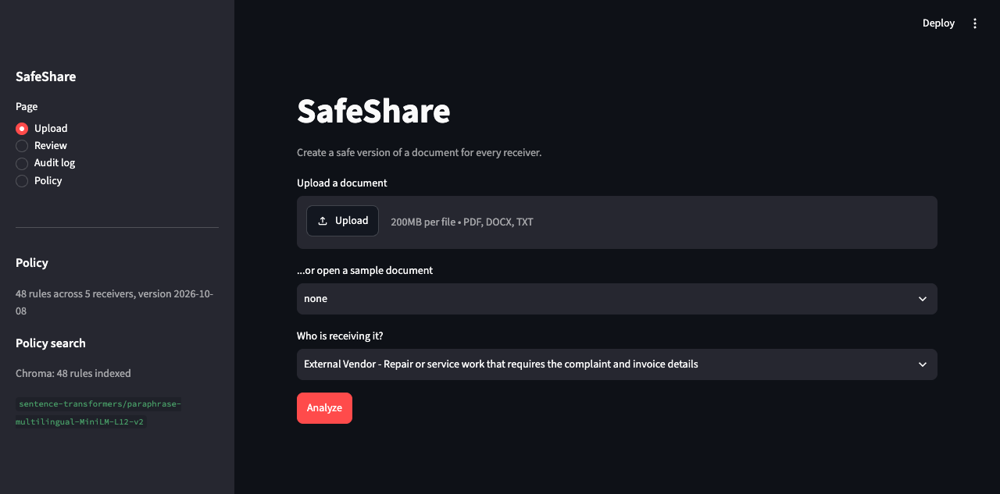
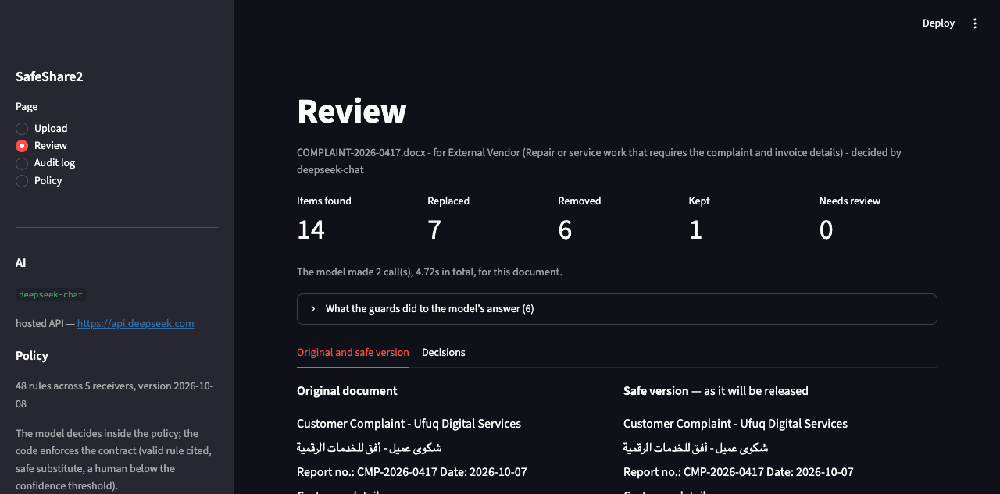
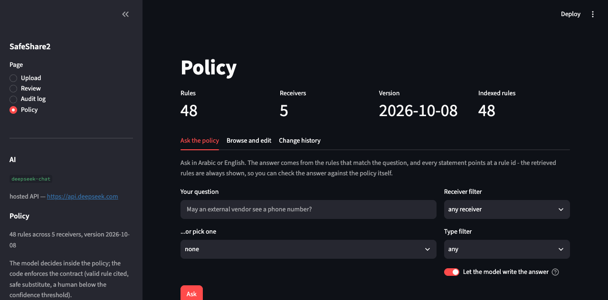

# SafeShare

**Create a safe version of a document for every receiver.**

SafeShare is a prototype application built around a language model. The
model reads the document, finds the personal data, chooses the action for the chosen
receiver, cites the policy rule, and writes the substitute and the reasons. 

## What it looks like







The code around the model owns three things:

1. **The policy.** `app/rules/rules.json` is the authority. The model is given the
   receiver's rules in its prompt and may not invent one. If it cites a rule that does not
   exist, or one that is about a different type of data, the item is not applied — it goes
   to a person.
2. **The contract on the answer.** A finding must exist in the document (found by exact
   match, or by a normalised match that folds Arabic-Indic digits). A change must cite a
   valid rule. A substitute must survive the validators (shape, checksum, obviously fake).
   Anything that fails goes back to a person rather than into a document.
3. **The safe default.** Below the confidence threshold the item goes to a human, and an
   item still waiting for a human is **left out of the release**, never left in.

---

## Quick start

```bash
cd safeshare2
pip install -r requirements.txt
streamlit run app/ui_streamlit.py      # the dashboard opens in your browser
```

That is it for the API provider: the key is in `.env` (see below) and nothing needs to be
downloaded. To run the model **on this machine** instead, there is one extra step — the
weights are ~6 GB and are not in this repository:

```bash
python -m scripts.setup_model          # downloads Qwen2.5-3B-Instruct (~6 GB, once)
SAFESHARE2_PROVIDER=local streamlit run app/ui_streamlit.py
```

### Where the model runs

`SAFESHARE2_PROVIDER` decides, and `auto` (the default) follows whether a key is present.

| setting | what happens | what leaves the machine |
|---|---|---|
| `api` | the document is sent to an OpenAI-compatible endpoint | **the document text, in the prompt** |
| `local` | Qwen runs here, in this process | nothing |
| `auto` | `api` when a key is configured, `local` otherwise | depends on the above |

```bash
SAFESHARE2_PROVIDER=api   SAFESHARE2_API_MODEL=deepseek-chat   # this build's setting
SAFESHARE2_PROVIDER=local                                      # back to the 3B model
```

The key lives in `.env` at the project root, which `app/config.py` reads at import (a real
environment variable always wins). **`.env` is not committed** — a live credential in git
history is leaked the moment the repository is shared. A fresh clone does this instead:

```bash
cp .env.example .env
# then put your own key in .env
```

`.env.example` (no key in it, safe to commit):

```
SAFESHARE2_PROVIDER=api
SAFESHARE2_API_BASE_URL=https://api.deepseek.com
SAFESHARE2_API_MODEL=deepseek-chat
DEEPSEEK_API_KEY=
```

The same three settings work as plain environment variables if you would rather not keep a
file at all:

```bash
SAFESHARE2_PROVIDER=api SAFESHARE2_API_MODEL=deepseek-chat DEEPSEEK_API_KEY=<your-key> \
  streamlit run app/ui_streamlit.py
```

### Why the model step is separate

This part applies to `SAFESHARE2_PROVIDER=local`. The weights are ~6 GB and are **not in
this repository** (they are in `.gitignore`). A fresh clone therefore has no model, and the
application will tell you so and stop. The install is one command, it resumes if
interrupted, and it is verified afterwards by checking that every shard named in the model
index is present and non-empty — an interrupted download looks finished until you check
that.

```bash
python -m scripts.setup_model --check      # is it installed? no download
python -m scripts.setup_model --json       # machine-readable status
```

With the API provider there is nothing to install: `setup_model` says so and exits without
downloading anything.

Where it goes: your Hugging Face cache (`~/.cache/huggingface/hub/...`), shared by every
project on the machine. Nothing is copied into this folder, so the clone stays small and
`git status` stays clean.

### What it needs

For the local model:

| | |
|---|---|
| Python | 3.10 or newer (built and tested on 3.13) |
| Disk | ~9 GB free: the decision model (~6 GB) **and** the policy embedder (~470 MB) |
| RAM / GPU | 16 GB RAM works on Apple Silicon (fp16, ~6 GB); a CUDA GPU is much faster, and NVIDIA users can drop to 4-bit |
| Network | needed **once**, for the two downloads. After that both models run offline |

For the API provider: Python and an internet connection. No GPU, no disk, no weights. The
policy index still runs locally either way — it embeds the policy, never a document.

**Chroma is a prerequisite of this build**, not an extra. It is what makes the policy
searchable, and `pip install -r requirements.txt` installs it: the release pipeline does
not need it, but the Policy page asked for in this build does. `python -m
scripts.setup_model --check` reports `chroma`, the embedder and the index separately, so a
missing piece is named rather than inferred. The index itself lives in `data/index/`
(git-ignored, disposable, rebuilt by `--rebuild-index`).

Both models are chosen by setting, and both are downloaded by `setup_model`:

```bash
SAFESHARE2_DEVICE=cuda SAFESHARE2_DTYPE=bfloat16 streamlit run app/ui_streamlit.py
SAFESHARE2_MODEL=Qwen/Qwen2.5-7B-Instruct ...        # any chat model on Hugging Face
SAFESHARE2_EMBED_MODEL=<sentence-transformers id>    # embedder for the policy index
SAFESHARE2_CHROMA_DIR=/path/to/index                 # where Chroma persists
SAFESHARE2_EMBED_OFFLINE=1                           # never download the embedder
```

---

## Run it

```bash
python3 tests/test_safeshare2.py       # 37 tests, no model needed, ~1 second
python -m scripts.smoke_test           # end to end, including the model
python -m scripts.make_demo_document   # rebuild the sample Arabic/English document

streamlit run app/ui_streamlit.py      # the dashboard: Upload → Review → Audit
uvicorn app.main:app --reload          # optional HTTP API at 127.0.0.1:8000/docs
```

The dashboard has the same three pages as the first prototype, plus a Policy page:

1. **Upload** — pick a document and choose the receiver; the reason for sharing comes from
   the receiver's own policy entry, not a text box. A panel
   shows whether the model is installed, on which device, and in which precision.
2. **Review** — original and safe version side by side, with one card per item: the value,
   the action, the rule the model cited, the model's own confidence, its reason, and — when
   the model was not trusted — the exact reason it was sent to you ("the model cited a rule
   that does not exist for this receiver"). An expander lists everything the guards changed
   about the model's answer.
3. **Audit** — every decision with its rule and reason, the AI's summary of the run, and
   the **model's footprint**: one row per model call with its purpose, tokens and seconds.
4. **Policy** — three tabs over `rules.json`, with Chroma underneath:
   - *Ask the policy*: type a question in Arabic or English ("may an external vendor see a
     phone number?") and get the rules that answer it, each with its id, action, reason and
     source citation. Citations are resolved in code, so a rule id the model mistypes is
     reported as a typo instead of being passed on, and an invented one is refused. The
     answer is optional — with the model uninstalled or switched off, the retrieved rules
     are still the answer.
   - *Browse and edit*: the rules as a table, and a form to change a rule's action, reason
     or source, add a rule, or delete one. Every write is validated against the same
     loader the pipeline uses, written atomically, version-bumped and recorded with a name
     and a timestamp. A rule's id and type are fixed — the audit log and the guards join on
     them — and the file stays the authority: the next analysis reads the new policy with
     no restart.
   - *Change history*: the append-only log of policy edits, with the rule before and after,
     so a release decided under `2026-10-08` can still be read against that policy.

The Policy page cannot change a document or a decision. It answers questions about the
policy and edits the policy; the release path is unchanged. That is deliberate: retrieval
may add context to a prompt, but it must never remove an item, satisfy a guard, or stand in
for a rule. A question the policy does not answer is reported as the policy being silent —
the same consequence as a missing rule, which is `ASK_HUMAN`.

---

## How it works

```
Document
  → the receiver's rules are put into the prompt (the policy, as data)
  → the model reads the document and proposes: value, type, action, rule, substitute, reason
  → guards enforce the contract (valid rule, value present, safe substitute)
  → a second, focused model call re-examines what the model itself was unsure about
  → anything still uncertain (or below 0.80 confidence) goes to a human
  → the reviewer's answer is final; unanswered items leave the release
  → the safe document is written (DOCX/TXT), the audit log records decisions and model calls
```

The model does four jobs, and there is one prompt for each (`app/llm/prompts.py`):

| job | what it is asked | code that checks it |
|---|---|---|
| `analyze` | read the document against the policy; list every item with type, action, cited rule, substitute, confidence, reason | every field validated; unknown types/actions refused; invented rules refused; value must be in the document |
| `adjudicate` | a second look at the items it was unsure about, with more surrounding text | the policy still decides the action; it may only point at a valid rule, and confidence is capped at 0.90 |
| `replacement` | invent a format-preserving, obviously fake substitute | shape and checksum validators; a bad substitute is replaced by the deterministic generator and the repair is recorded |
| `summary` | write the audit note for the run | numbers only; no names, no values; stored with the run |

Models are optional in the first prototype and mandatory here, so a failure is loud: if
the model returns something unusable, the call raises and the dashboard says nothing was
analysed, instead of showing an empty, falsely reassuring result.

---

## Privacy

- **Where the text goes depends on the provider** (`SAFESHARE2_PROVIDER`):
  - `local` — the document is read, analysed and released on this machine. Nothing is
    sent anywhere.
  - `api` — the document text is sent to the configured endpoint
    (`SAFESHARE2_API_BASE_URL`) in the prompt, because that is how the model is asked.
    That is the whole trade for the speed, and it is the one thing in this project that
    leaves the machine. The dashboard's Privacy panel says which mode is active, and the
    upload page reports it per run.
- **No telemetry**, and the only credential is the API key in `.env` (see *Where the model
  runs*) — removed and rotated after the demo.
- **Uploads are not kept.** A file is written to the temporary folder only long enough to
  read it, then deleted (`SAFESHARE2_KEEP_UPLOADS=1` changes that for debugging).
- **The audit log stores no original value.** Each row keeps a masked rendering
  (`A******h M*******d`) and a short hash. Model calls are recorded as a prompt **hash**,
  sizes, tokens and seconds — never the prompt, because the prompt contains document text.
  This holds for both providers.

---

## Project layout

```
safeshare2/
├── app/
│   ├── ui_streamlit.py          the three-page dashboard
│   ├── main.py                  optional FastAPI backend (/api/analyze, /api/release, /api/audit)
│   ├── core.py                  the pipeline: the model decides, the code applies
│   ├── guards.py                the contract: valid rule, value present, safe substitute
│   ├── config.py                every setting, including the model and its precision
│   ├── llm/
│   │   ├── engine.py            load the model, talk to it, parse JSON, record calls
│   │   └── prompts.py           the four prompts - the product
│   ├── rules/                   rules.json (48 rules, 5 receivers) + loader
│   ├── pii_detection/           the type/action contract + Arabic digit folding
│   ├── replacement/             the validated synthetic-value generator
│   ├── document_processing/     PDF/DOCX/TXT readers, structure-preserving writer
│   ├── review/                  the human-review queue
│   └── audit/                   SQLite log: decisions, runs, model calls
├── scripts/
│   ├── setup_model.py           the prerequisite installer
│   ├── smoke_test.py            end-to-end verification
│   └── make_demo_document.py    rebuild the sample document
├── tests/test_safeshare2.py     22 tests, no model required
├── data/synthetic/              our own sample document (Arabic + English + a table)
└── docs/                        SETUP · PIPELINE · AI · DEMO
```

---

## Pushing this to GitHub (and running it on another machine)

The repository is ready for it: no weights, no local paths in code, and exactly one secret
- the temporary API key in `.env`, which is committed on purpose for now (see *Where the
model runs*) and must be rotated and removed before this goes anywhere public.

```bash
cd safeshare2
git add .
git commit -m "SafeShare: purpose-bound release with a local model at the core"
git remote add origin git@github.com:<account>/safeshare2.git
git push -u origin main
```

On the new machine:

```bash
git clone git@github.com:<account>/safeshare2.git
cd safeshare2
python3 -m venv .venv && source .venv/bin/activate
pip install -r requirements.txt
python -m scripts.setup_model            # the model, once
python3 tests/test_safeshare2.py         # 22 tests should pass
python -m scripts.smoke_test             # end to end, now including the model
streamlit run app/ui_streamlit.py
```

A GPU box needs nothing extra: the same commands, and the device/precision are picked up
automatically (`cuda` in bfloat16 or float16 instead of `mps` in float16).

---

## Honest limitations

- **A 3B model is a small model.** It handles these documents well and it is fast enough
  on a laptop, but it will miss things a larger model catches, especially in dense Arabic
  free text. That is exactly why the confidence threshold, the guards and the review page
  exist: the system is built to ask rather than to be trusted. Larger models are one
  setting away (`SAFESHARE2_MODEL=Qwen/Qwen2.5-7B-Instruct`) and need more memory.
- **Speed is real.** On an Apple Silicon laptop, a one-page document is a handful of
  seconds per model call; a long document is chunked, so it is a multiple of that. On a
  CUDA GPU it is several times faster. The dashboard reports the actual seconds per run.
- **The prompts are the quality.** Changing the prompt changes the product. They live in
  one file, they are versioned with the code, and `docs/AI.md` explains each one.
- **PDF layout is not preserved** on the way out: PDFs are read fine, and the release is
  written as DOCX with a note.
- **Everything here is synthetic.** The sample and policy are ours; nothing has been run
  against a real company document.
- Code was written with an AI assistant (Hermes Agent) and reviewed, run and tested by the
  team. AI use is disclosed, as the project brief requires.

## Licence

MIT — see `LICENSE`. The model is Apache-2.0 (`Qwen/Qwen2.5-3B-Instruct`); it is downloaded
at setup time and is not redistributed here.
